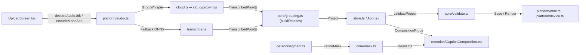

# 🧠 Cérebro do Projeto (Project Brain Map + Graphify) — `editor-legenda`

> **Versão Oficial:** `v1.2.0` (Consolidada) | Memória de sessão e deploy: [`docs/CEREBRO.md`](file:///Users/joaogabrielzava/Projetos/editor-legenda/docs/CEREBRO.md) | **Kanban Oficial:** [`docs/KANBAN.md`](file:///Users/joaogabrielzava/Projetos/editor-legenda/docs/KANBAN.md) & [`public/kanban.html`](file:///Users/joaogabrielzava/Projetos/editor-legenda/public/kanban.html) (`http://127.0.0.1:5173/kanban.html`) | Canal Claude ↔ Antigravity: [`docs/COLAB.md`](file:///Users/joaogabrielzava/Projetos/editor-legenda/docs/COLAB.md) | Plano Fase 2: [`docs/PLANO_REVISAO.md`](file:///Users/joaogabrielzava/Projetos/editor-legenda/docs/PLANO_REVISAO.md) | Plano Strix: [`docs/PLANO_STRIX.md`](file:///Users/joaogabrielzava/Projetos/editor-legenda/docs/PLANO_STRIX.md) | Escala Futura: [`docs/ESCALA_FUTURA.md`](file:///Users/joaogabrielzava/Projetos/editor-legenda/docs/ESCALA_FUTURA.md) | Manual: [`docs/MANUAL.md`](file:///Users/joaogabrielzava/Projetos/editor-legenda/docs/MANUAL.md) | Relatório Graphify: [`graphify-out/GRAPH_REPORT.md`](file:///Users/joaogabrielzava/Projetos/editor-legenda/graphify-out/GRAPH_REPORT.md)

---

## 1. Nódulo Central (Core Architecture)
- **Propósito**: Editor profissional de legendas animadas estilo Reels (`@_k.elsie`), multiplataforma (Desktop Mac + PWA iPhone).
- **Stack**: TypeScript, React, Vite, Remotion (`@remotion/player`, `@remotion/renderer`, `@remotion/web-renderer`), Express (local Mac), MediaPipe (segmentação de pessoa), Groq Whisper / Transformers.js (transcrição), `mediabunny` (streaming de áudio/vídeo), Vitest.
- **Princípios Inegociáveis**:
  - Estilo é dado puro (JSON em `PRESETS`).
  - Validação estrita contra XSS/CSS injection (`url(`, `expression(`, `<script`) e path traversal (`inside()`).
  - Paridade de composição entre Preview, Render Servidor (Mac) e Render Browser (PWA).
  - Trabalho em Dupla (**Claude Code ↔ Antigravity**): 1 lote atômico por vez em [`docs/COLAB.md`](file:///Users/joaogabrielzava/Projetos/editor-legenda/docs/COLAB.md), revisão cruzada (`APROVADO` / `MUDAR`) e `npm run verify` com 0 erros antes de cada commit.
  - **Kanban Vivo Obrigatório (`docs/KANBAN.md` + `public/kanban.html`)**: Antigravity e Claude Code devem atualizar o Kanban a cada tarefa planejada, enfileirada, executada, corrigida, finalizada ou descartada, sempre com **Linguagem Popular** + **Engenharia de Software** + **O que altera** + **Qual era o Erro** + **Resultado Final**.

---

## 2. Grafo de Conhecimento Graphify (`graphify-out/`)

Grafo estrutural + semântico extraído via AST e clusterizado com detecção de comunidades:
- **Métricas do Grafo**: **640 nós** · **1.489 arestas** · **57 comunidades** · **0 ciclos de importação**.
- **Arquivos do Grafo**:
  - [`graphify-out/GRAPH_REPORT.md`](file:///Users/joaogabrielzava/Projetos/editor-legenda/graphify-out/GRAPH_REPORT.md): Relatório de comunidades, God Nodes e conexões.
  - [`graphify-out/graph.json`](file:///Users/joaogabrielzava/Projetos/editor-legenda/graphify-out/graph.json): Grafo navegável para consultas rápidas de agentes (`graphify query`).
  - `graphify-out/graph.html`: Visualização interativa HTML local.

### 🌟 God Nodes (Abstrações Mais Conectadas do Sistema)
1. [`Project`](file:///Users/joaogabrielzava/Projetos/editor-legenda/src/core/types.ts#L81-L92) (**25 conexões**) — Contrato central de estado validado entre UI, Remotion, Servidor e IndexedDB.
2. [`phraseStart()`](file:///Users/joaogabrielzava/Projetos/editor-legenda/src/core/grouping.ts#L129-L131) (**21 conexões**) & [`phraseEnd()`](file:///Users/joaogabrielzava/Projetos/editor-legenda/src/core/grouping.ts#L133-L135) (**17 conexões**) — Âncoras de tempo de toda a timeline, agrupamento e composição.
3. [`findPreset()`](file:///Users/joaogabrielzava/Projetos/editor-legenda/src/core/presets.ts#L211-L214) (**19 conexões**) — Resolução de modelos P1–P8 e presets personalizados do usuário.
4. [`Platform`](file:///Users/joaogabrielzava/Projetos/editor-legenda/src/app/platform/types.ts#L19-L41) (**17 conexões**) — Interface polimórfica que isola `macPlatform` (Express/FFmpeg) de `devicePlatform` (IndexedDB/WebCodecs).
5. [`App()`](file:///Users/joaogabrielzava/Projetos/editor-legenda/src/app/App.tsx#L39-L360) (**16 conexões**) & [`Timeline()`](file:///Users/joaogabrielzava/Projetos/editor-legenda/src/app/components/Timeline.tsx#L41-L320) (**15 conexões**) — Orquestradores de interação da interface.
6. [`TranscribedWord`](file:///Users/joaogabrielzava/Projetos/editor-legenda/src/core/transcript.ts#L1-L6) (**14 conexões**) — Elo comum entre Groq Cloud, OpenAI e Whisper Local ONNX.

### 🔍 Comandos Rápidos do Graphify (Sem Re-extrair)
```bash
# Consultar contexto no grafo (BFS/DFS):
graphify query "CaptionComposition useMask"
# Menor caminho arquitetural entre dois símbolos:
graphify path "UploadScreen" "CaptionComposition"
# Explicar vizinhança de um nó:
graphify explain "validateProject"
```

---

## 3. A Teia de Ramificações (Knowledge Graph / Modularity)
- 🕸️ **Domain / Core Logic (`src/core/`)**:
  - [`src/core/types.ts`](file:///Users/joaogabrielzava/Projetos/editor-legenda/src/core/types.ts): Contratos de projeto, frases, palavras e estilos.
  - [`src/core/presets.ts`](file:///Users/joaogabrielzava/Projetos/editor-legenda/src/core/presets.ts): Modelos P1–P8.
  - [`src/core/fonts.ts`](file:///Users/joaogabrielzava/Projetos/editor-legenda/src/core/fonts.ts): Catálogo de 58 fontes OFL categorizadas.
  - [`src/core/grouping.ts`](file:///Users/joaogabrielzava/Projetos/editor-legenda/src/core/grouping.ts): Agrupamento de frases, papéis gramaticais PT-BR, `retextPhrase` e `shiftPhrase`.
  - [`src/core/edit.ts`](file:///Users/joaogabrielzava/Projetos/editor-legenda/src/core/edit.ts): Operações de timeline (split, trim, move, snap, search/replace).
  - [`src/core/layout.ts`](file:///Users/joaogabrielzava/Projetos/editor-legenda/src/core/layout.ts) & [`src/core/motion.ts`](file:///Users/joaogabrielzava/Projetos/editor-legenda/src/core/motion.ts): Posicionamento, curvas de animação, Karaokê 2.0 (`highlightPop`) e contador `counterText`.
  - [`src/core/emojis.ts`](file:///Users/joaogabrielzava/Projetos/editor-legenda/src/core/emojis.ts): Sugestão offline de emojis por contexto semântico (PT/EN/ES).
  - [`src/core/mask.ts`](file:///Users/joaogabrielzava/Projetos/editor-legenda/src/core/mask.ts): Refino temporal e espacial de máscaras de segmentação.
  - [`src/core/exporters.ts`](file:///Users/joaogabrielzava/Projetos/editor-legenda/src/core/exporters.ts): Exportação SRT e ASS (com estilos por preset, karaokê `\kf`, 3D `\frx/\fry` e escala X/Y por palavra).
  - [`src/core/validate.ts`](file:///Users/joaogabrielzava/Projetos/editor-legenda/src/core/validate.ts): Sanitização profunda de `Project`, `TextStyle` e `customPresets` com proteção contra XSS/CSS injection.
- 🕸️ **Render Engine (`src/remotion/`)**:
  - [`src/remotion/CaptionComposition.tsx`](file:///Users/joaogabrielzava/Projetos/editor-legenda/src/remotion/CaptionComposition.tsx): Composição única (suporta oclusão `useMask`, `clearMaskCache`, Karaokê 2.0 e camada `person`).
  - [`src/remotion/fonts.ts`](file:///Users/joaogabrielzava/Projetos/editor-legenda/src/remotion/fonts.ts): Carregamento local de fontes e medição em canvas com cache LRU.
- 🕸️ **UI / Components (`src/app/`)**:
  - [`src/app/App.tsx`](file:///Users/joaogabrielzava/Projetos/editor-legenda/src/app/App.tsx): Orquestrador da interface (Topbar, Library, Preview, PhrasePanel, Timeline, ExportPanel).
  - [`src/app/store.ts`](file:///Users/joaogabrielzava/Projetos/editor-legenda/src/app/store.ts): Estado imutável com histórico Undo/Redo (100 passos).
  - [`src/app/person/segment.ts`](file:///Users/joaogabrielzava/Projetos/editor-legenda/src/app/person/segment.ts) & [`src/app/components/PersonPanel.tsx`](file:///Users/joaogabrielzava/Projetos/editor-legenda/src/app/components/PersonPanel.tsx): Segmentação MediaPipe no browser.
  - [`src/app/transcribe.ts`](file:///Users/joaogabrielzava/Projetos/editor-legenda/src/app/transcribe.ts) & [`src/app/cloud.ts`](file:///Users/joaogabrielzava/Projetos/editor-legenda/src/app/cloud.ts): Transcrição local (ONNX/WASM/WebGPU) e nuvem (Groq).
  - [`src/app/waveform.ts`](file:///Users/joaogabrielzava/Projetos/editor-legenda/src/app/waveform.ts): Extração de picos de forma de onda em streaming via `mediabunny`.
- 🕸️ **Platform, Entrypoints & CI Security (`src/app/platform/`, `server/`, `cloud/`, `.github/workflows/`, `eslint.config.mjs`)**:
  - [`src/app/platform/mac.ts`](file:///Users/joaogabrielzava/Projetos/editor-legenda/src/app/platform/mac.ts) vs [`src/app/platform/device.ts`](file:///Users/joaogabrielzava/Projetos/editor-legenda/src/app/platform/device.ts): Abstração Desktop vs PWA (IndexedDB + revogação automática de Blob URLs).
  - [`server/index.ts`](file:///Users/joaogabrielzava/Projetos/editor-legenda/server/index.ts) & [`server/render.ts`](file:///Users/joaogabrielzava/Projetos/editor-legenda/server/render.ts): API Express local (`127.0.0.1:3210`) e fila `@remotion/renderer` com cancelamento real (`DELETE /api/render/:id`).
  - [`cloud/proxy.mjs`](file:///Users/joaogabrielzava/Projetos/editor-legenda/cloud/proxy.mjs): Proxy Render para transcrição Groq com rate-limit LRU por IP real.
  - [`eslint.config.mjs`](file:///Users/joaogabrielzava/Projetos/editor-legenda/eslint.config.mjs) & [`.github/workflows/ci.yml`](file:///Users/joaogabrielzava/Projetos/editor-legenda/.github/workflows/ci.yml): Lint TS/JS, gate de segurança de PR e `npm run verify` automatizado.

---

## 4. Matriz de Roteamento Rápido ("Onde ir em cada situação")
- *Sincronização entre Agentes (Claude ↔ Antigravity)* ➔ [`docs/COLAB.md`](file:///Users/joaogabrielzava/Projetos/editor-legenda/docs/COLAB.md)
- *Novos Modelos / Presets de Legenda* ➔ [`src/core/presets.ts`](file:///Users/joaogabrielzava/Projetos/editor-legenda/src/core/presets.ts)
- *Renderização Visual / Karaokê / Oclusão* ➔ [`src/remotion/CaptionComposition.tsx`](file:///Users/joaogabrielzava/Projetos/editor-legenda/src/remotion/CaptionComposition.tsx)
- *Recorte da Pessoa (MediaPipe / Máscara)* ➔ [`src/app/person/segment.ts`](file:///Users/joaogabrielzava/Projetos/editor-legenda/src/app/person/segment.ts) e [`src/core/mask.ts`](file:///Users/joaogabrielzava/Projetos/editor-legenda/src/core/mask.ts)
- *Transcrição (Groq Nuvem ou Whisper Local)* ➔ [`src/app/cloud.ts`](file:///Users/joaogabrielzava/Projetos/editor-legenda/src/app/cloud.ts), [`cloud/proxy.mjs`](file:///Users/joaogabrielzava/Projetos/editor-legenda/cloud/proxy.mjs) e [`src/app/transcribe.ts`](file:///Users/joaogabrielzava/Projetos/editor-legenda/src/app/transcribe.ts)
- *Exportação SRT / ASS / Vídeo* ➔ [`src/core/exporters.ts`](file:///Users/joaogabrielzava/Projetos/editor-legenda/src/core/exporters.ts) e [`src/app/components/ExportPanel.tsx`](file:///Users/joaogabrielzava/Projetos/editor-legenda/src/app/components/ExportPanel.tsx)
- *Segurança de Schema / Servidor / CI* ➔ [`src/core/validate.ts`](file:///Users/joaogabrielzava/Projetos/editor-legenda/src/core/validate.ts), [`server/index.ts`](file:///Users/joaogabrielzava/Projetos/editor-legenda/server/index.ts) e [`.github/workflows/ci.yml`](file:///Users/joaogabrielzava/Projetos/editor-legenda/.github/workflows/ci.yml)

---

## 5. Grafo de Relações e Dependências Cruzadas

